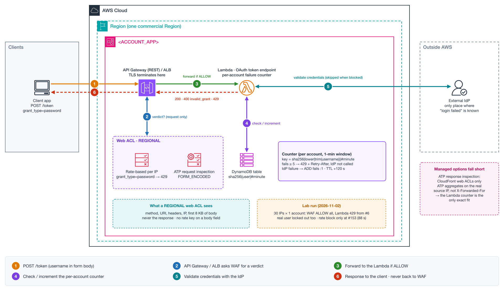

# NET-023 — Per-Account Login Failure Limiting on a Custom OAuth Token Endpoint

**Tier:** Lab — reproducible end to end
**Status:** Lab built, run and torn down on 2026-11-02 with ATP enabled ([lab/](lab/)). Teardown verified: no resources left. Results below.
**Services:** AWS WAF (rate-based rules, ATP) · API Gateway / Application Load Balancer · Lambda · DynamoDB · CloudFront (optional)



[Interactive explainer](explainers/explainer.html)

## Business Context — SaaS provider / Multi-tenant platform with its own OAuth server

A SaaS provider runs its own OAuth 2.0 authorization server instead of a managed identity service.
Client applications get tokens through the resource owner password grant. An external identity
provider validates the credentials.

Requirements:
- Protect the token endpoint against **distributed credential stuffing**: many source IPs, few
  attempts per IP.
- Return **HTTP 429** once an account exceeds **5 failed logins per minute**.
- The limit is **per account**, not per source IP.
- Prefer an AWS-native, managed capability before building one.

## Problem Statement

- The team already plans an AWS WAF rate-based rule per source IP on the token endpoint. That rule
  controls volume, but a distributed attack stays under any per-IP threshold.
- They identified two gaps and asked if AWS offers a managed way around them:
  1. **WAF never sees whether a login failed.** Success or failure is decided inside the Lambda,
     after WAF has let the request through.
  2. **Rate-based rules can't aggregate on a body field.** The username is in the
     `application/x-www-form-urlencoded` body, and no custom aggregation key reads the body.
- Their fallback: a per-username failure counter inside the Lambda, backed by DynamoDB.

## Architecture

- **Account:** `<ACCOUNT_APP>` (single account). Region: one commercial Region.
- **Edge:** no CloudFront. The web ACL is **REGIONAL** and associated with API Gateway (REST) or
  an ALB.
- **Compute:** a Node.js Lambda implements the OAuth token endpoint.
- **Identity:** an external identity provider, called from the Lambda over HTTPS.
- **Request:** `POST /token` with
  `grant_type=password&username=<user>&password=<pass>&client_id=<client>`.

### Request path and what WAF can see

```
Client ──TLS──▶ API Gateway / ALB ──verdict?──▶ AWS WAF (REGIONAL)
                       │                          sees: method, URI, headers, IP, first 8 KB of body
                       ▼
                    Lambda ──HTTPS──▶ External IdP      ← only here is "login failed" known
                       │
Client ◀── 200 token / 400 invalid_grant ── API Gateway / ALB   ← response never goes back to WAF
```

- TLS terminates at API Gateway or the ALB. That is where the request is plain HTTP, so that is
  where WAF is called.
- The integration asks WAF for a verdict **once, on the request**. The response from the Lambda
  returns to the client without a second WAF call.

## Analysis

Both gaps are real and confirmed in the AWS WAF documentation.

| Limit | Detail |
|---|---|
| No visibility into the login result | Only **ATP response inspection** reads responses, and it is **available only for web ACLs that protect CloudFront distributions**. Inspection is asynchronous, so it affects the *next* request, never the current one. |
| No body-based aggregation key | Rate-based custom keys are: IP, forwarded IP, ASN, label namespace, header, cookie, query argument, query string, URI path, JA3, JA4, HTTP method. The body is not one of them. |

### Options

| Option | Per account? | Counts failures? | Threshold configurable? | Notes |
|---|---|---|---|---|
| **A. ATP request inspection** (`AWSManagedRulesATPRuleSet`, payload `FORM_ENCODED`) | Partial | No | No | `AttributePasswordTraversal` flags many passwords for the same username. Also compromised credentials, username traversal, `VolumetricIpHigh` (>20 per IP / 10 min). Works on REGIONAL web ACLs. Extra cost. |
| **B. ATP response inspection** | No (IP and session) | Yes | No | CloudFront only. `VolumetricIpFailedLoginResponseHigh` (>10 per IP / 10 min) and `VolumetricSessionFailedLoginResponseHigh` (>10 per session / 30 min, needs a token). A distributed, tokenless attack avoids both. |
| **C. Hashed-username header + rate-based rule** | Yes | No | Yes | Only works if the client app is first-party. The client controls the header, so an attacker drops or rotates it. Needs a companion rule that blocks `/token` without the header. |
| **D. Failure counter in the Lambda** | Yes | Yes | Yes | **The only option that meets the exact requirement.** |
| **E. Account lockout in the IdP** | Yes | Yes | Depends | Many IdPs already lock accounts on repeated failures. The Lambda can map that error to 429. Outside AWS — confirm with the IdP vendor. |

## Recommendation

There is no managed AWS capability that returns 429 after *N failed logins per minute per
account*. The custom counter is the right design. WAF stays in front as the volumetric and
reputation layer.

1. **Rate-based rule per IP** on `/token`, scoped down to `grant_type=password`. Action Block with a
   custom 429 response.
2. **ATP** with login path `/token`, payload type `FORM_ENCODED`, username and password field
   names. Adds the stolen-credential check and the password-traversal signal.
3. **Optional:** put CloudFront in front to enable ATP response inspection (failures per IP and
   session).
4. **Per-account failure counter in the Lambda:**
   ```
   key    = sha256(lower(trim(username))) + "#" + floor(epoch / 60)
   before = GetItem(key) → fails >= 5 → 429 + Retry-After, do not call the IdP
   after  = IdP failure only → UpdateItem ADD fails :1, SET ttl = epoch + 120   (atomic)
   ```
   A fixed one-minute window is cheap and simple. For a sliding window, weight the previous
   minute's count.
5. **Check the IdP lockout policy** and align it with the Lambda limit.

## Observed Results (lab run, 2026-11-02)

REGIONAL web ACL on an API Gateway REST stage, rate-based rule at 100 requests / 5 min per
forwarded IP, ATP in Count.

| Phase | What was sent | Result |
|---|---|---|
| A | Correct login | 200 from the Lambda |
| B | 30 wrong passwords for one account, 30 different `X-Forwarded-For` IPs, < 1 min | Attempts 1-5 → 400 `invalid_grant`. Attempts 6-30 → **429 from the Lambda**. WAF logged every request as **ALLOW** |
| C | Same account, correct password, same minute | **429** — the lockout blocked the real user too |
| D | One forwarded IP, random usernames, 4 req/s | First WAF block at request **153**, after **88 s** (limit 100): mitigation lag of ~50 requests |

What the lab showed beyond the design:

- **WAF never saw the distributed attack.** Every phase-B request was allowed; only the counter in
  the Lambda stopped it.
- **ATP aggregates on the real source IP, not on `X-Forwarded-For`.** All lab traffic came from one
  host, so ATP labeled it `aggregate:volumetric:ip:low` even though the rate-based rule saw 30 different
  forwarded IPs. A distributed attack from real IPs would not get that label.
- **No `password_traversal` label** appeared for 30 wrong passwords against one account in under a
  minute.
- **Behind API Gateway, the WAF custom response header arrives as-is** (`lab-source: waf`), not
  prefixed with `x-amzn-waf-`, and API Gateway adds `x-amzn-ErrorType: ForbiddenException` even
  though the status code is the custom 429.
- **A new REST stage took more than 2 minutes** before `AssociateWebACL` stopped returning
  `WAFUnavailableEntityException`.
- **WAF logs reach CloudWatch Logs with a delay** of a few minutes; query again before concluding
  that requests are missing.

## Lab Run — Deploy, Test, Teardown (2026-11-02)

Full guide and console checks: [lab/README.md](lab/README.md).

| Stage | What happened | Notes |
|---|---|---|
| Deploy 1-6 | Table + TTL, IAM role, Lambda, REST API + stage, web ACL (rate-based + ATP in Count), WAF logging | Created in under 2 minutes |
| Deploy 7 | `AssociateWebACL` failed for ~100 s with `WAFUnavailableEntityException` | The new REST stage needed **more than 2 minutes** to become visible to WAF. A manual retry succeeded. Fix: the script now retries for up to 6 minutes |
| Test A-C | Behaved as designed on the first run | See Observed Results |
| Test D (1st run) | The script reported "no WAF block", but the WAF logs showed **157 BLOCKs** by `RateLimitPerForwardedIP` | Cause: the script looked for `x-amzn-waf-lab-source`; behind API Gateway the header arrives as `lab-source`. Fix: detect both |
| Test D (rerun, new IP) | First block at request 153, after 88 s | Mitigation lag measured |
| Logs | Some WAF records showed up in CloudWatch Logs minutes later | Query again before concluding that requests are missing |
| Teardown | Disassociate → logging → web ACL → API → Lambda → role → table → log groups | Verified per resource type and with a `Project=NET-023` tag search: **none left**. ATP billing stops with the web ACL |

## Common Mistakes

- **Lockout as a denial of service.** An attacker can lock real users on purpose. Keep the window
  short, return a generic error, and prefer step-up (CAPTCHA, MFA) over long lockouts.
- **A "JSON body custom key" for rate-based rules.** It doesn't exist.
- **ATP response inspection on a REGIONAL web ACL.** It only runs for CloudFront.
- **Expecting an exact limit from WAF.** Rate-based rules and ATP have mitigation lag; some
  requests get through before the block starts.
- **CAPTCHA on an API `POST`.** The client gets HTTP 405 and can't render the puzzle. On an API,
  block with 429.
- **Normalizing the username after hashing.** `User` and `user` end up in different counters.

## Troubleshooting Path

1. Confirm the web ACL scope and association:
   `aws wafv2 get-web-acl-for-resource --resource-arn <api-stage-or-alb-arn>` (`REGIONAL` vs
   `CLOUDFRONT`).
2. Confirm the login request format (`Content-Type`, field names) from WAF logs or a test request.
3. List the ATP labels and rule names:
   `aws wafv2 describe-managed-rule-group --vendor-name AWS --name AWSManagedRulesATPRuleSet --scope REGIONAL`.
4. In WAF logs, filter `/token` and check `labels` for `atp:` signals and which rule terminated.
5. In the Lambda, log `hash(username)`, the window counter and the 429 decision. Confirm that
   failures from many IPs land on the same key.

## Lab Reproduction Notes

Built and run — see [lab/](lab/) for the script, the step-by-step console guide and the annotated
WAF log.

```bash
cd lab
python deploy_lab.py deploy --profile <lab-profile> [--atp]   # ~3-6 min, association waits for the stage
python deploy_lab.py test --profile <lab-profile>             # phases A-D, prints a run tag
python deploy_lab.py logs <run-tag> --profile <lab-profile>   # wait a few minutes for WAF logs
python deploy_lab.py teardown --profile <lab-profile>         # must end with "leftovers: none"
```

- **Simulating a distributed attack from one host:** the rate-based rule aggregates on
  `X-Forwarded-For`, so one machine acts as many IPs. ATP still sees the one real source IP.
- **Cost drivers:** ATP (monthly fee prorated + per request) — run teardown in the same session.
  Without `--atp` the cost is negligible.

## Learning Exercises

1. Move the username to a hashed header (option C) and show how an attacker bypasses it.
2. Replace the fixed window with a sliding window and compare false positives at the boundary.
3. Add a per-account + per-IP composite key in DynamoDB and measure how it limits lockout abuse.
4. ~~Enable ATP on the REGIONAL web ACL and check which labels a password-spray pattern produces.~~ Done in the first run: only `volumetric:ip:low`, keyed on the real source IP. Repeat from several real hosts.
5. Put the same API behind CloudFront and measure how long ATP response inspection takes to block.

## References

- [ATP managed rule group](https://docs.aws.amazon.com/waf/latest/developerguide/aws-managed-rule-groups-atp.html)
- [Configuring ATP](https://docs.aws.amazon.com/waf/latest/developerguide/waf-atp.html)
- [Rate-based rule aggregation options](https://docs.aws.amazon.com/waf/latest/developerguide/waf-rule-statement-type-rate-based-aggregation-options.html)
- [Rate-based rule caveats (mitigation lag)](https://docs.aws.amazon.com/waf/latest/developerguide/waf-rule-statement-type-rate-based-caveats.html)
- [CAPTCHA and Challenge best practices](https://docs.aws.amazon.com/waf/latest/developerguide/waf-captcha-and-challenge-best-practices.html)
- [DynamoDB TTL](https://docs.aws.amazon.com/amazondynamodb/latest/developerguide/TTL.html)
