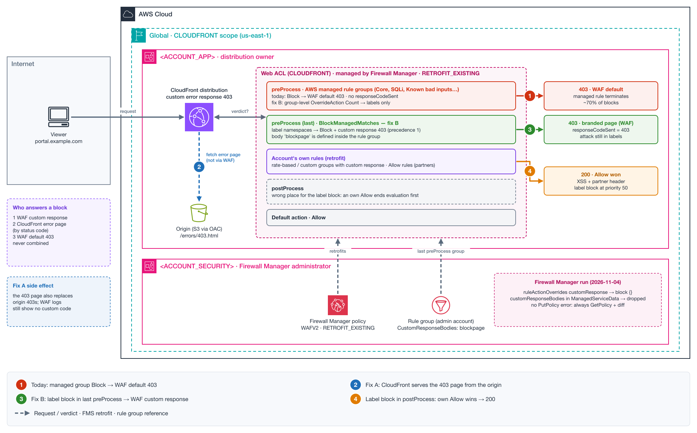

# NET-024 — One Custom Block Response for Every WAF Block, Including AWS Managed Rule Groups

**Tier:** Lab — reproducible end to end
**Status:** Lab built and run on 2026-11-02 ([lab/](lab/)) with Firewall Manager simulated by web ACL priorities. **Firewall Manager part run on 2026-11-04** in a two-account AWS Organizations lab (FMS administrator + member, `RETROFIT_EXISTING`). Results below.
**Services:** AWS WAF (custom responses, managed rule groups, rule action overrides, labels) · AWS Firewall Manager (WAFV2 policy, `RETROFIT_EXISTING`) · CloudFront (custom error responses)



[Interactive explainer](explainers/explainer.html)

## Business Context — Banking / Developer portal (pre-production)

A bank publishes a developer portal behind CloudFront. A security team manages WAF centrally with
Firewall Manager and wants every blocked request to show the same branded block page.

Requirements:
- **One block page** for every WAF block, whatever rule blocked it.
- WAF stays managed by Firewall Manager; the web ACL is retrofitted (`webACLSource = RETROFIT_EXISTING`).
- No loss of protection while changing how blocks are answered.

## Problem Statement

- Blocks from the team's own rules (rate-based and custom rule groups) return the custom response.
- Blocks from **AWS managed rule groups** (Core, SQL database, Known Bad Inputs, Linux, POSIX, Windows,
  PHP, WordPress, IP reputation) return the **default 403** instead.
- One week of WAF logs: ~60k blocks. About 30% have `responseCodeSent` (own rules with a custom
  response). About 70% have **no `responseCodeSent`** (managed rule groups, default response).
- The team asked:
  1. Is there a web ACL or Firewall Manager setting that applies one custom block response to all rules?
  2. Can a Firewall Manager `ruleActionOverrides` entry use Block with a CustomResponse on AWS managed rule groups?
  3. If not, is "managed groups in Count + block on their labels later" the recommended approach — group-level `OverrideAction` or rule-level overrides?
  4. In a retrofitted web ACL, should the label-blocking group be the last preProcess group, so own Allow rules can't end evaluation first?

## Architecture

- **Accounts:** `<ACCOUNT_SECURITY>` (Firewall Manager administrator) and `<ACCOUNT_APP>` (distribution owner).
- **Edge:** one CloudFront distribution for `portal.example.com`. Web ACL scope `CLOUDFRONT` (resources in `us-east-1`).
- **Web ACL evaluation order with Firewall Manager:**

```
FMS preProcess rule groups      ← AWS managed rule groups live here today (action Block)
Account's own rules (retrofit)  ← may include Allow rules (partners, health checks…)
FMS postProcess rule groups
Default action (Allow)
```

## Analysis

### Which response a blocked request gets (documented precedence)

```
1. Custom response on the WAF Block action      → used, nothing else applies
2. Custom response defined in the protected resource (CloudFront custom error response by status code)
3. WAF default Block response                   → 403 Forbidden
```

The response comes entirely from WAF or entirely from the protected resource; they don't combine.
Managed rule group rules have no custom response, so they fall through to 2 or 3.

### Answers

| Question | Answer |
|---|---|
| 1. One setting for all rules | **Not in WAF and not in Firewall Manager.** A custom response is set per Block action (rule, rule action override, or the web ACL default action). The Firewall Manager policy's `customResponse` field sits next to `defaultAction` and applies only to the default action — and retrofit doesn't change the default action. **CloudFront can do it:** a custom error response for 403 covers every block that has no WAF custom response. |
| 2. Block + CustomResponse in `ruleActionOverrides` | **WAF API:** `ActionToUse` is a full `RuleAction`, so Block with `CustomResponse` is valid in a web ACL you own. **Firewall Manager: not supported.** `PutPolicy` succeeds, but the stored policy and the retrofitted web ACL show `{"block": {}}` — the custom response is **silently removed**, with no validation error (lab, 2026-11-04). |
| 3. Count + label block | Valid pattern. Prefer **group-level `OverrideAction: Count`**: it covers future rules added to the managed group. Rule-level overrides need every rule name, and WAF silently ignores invalid names on managed groups. |
| 4. Position in a retrofitted web ACL | **Last preProcess group**, after the managed groups in Count. In postProcess, an own Allow rule in the middle ends evaluation first and attacks that are blocked today would pass. |

## Recommendation

1. **Simplest:** add a CloudFront custom error response for **403** that serves the block page.
   No WAF or Firewall Manager change. Keep the existing WAF custom responses identical in content, or
   remove them, so all blocks look the same.
2. **If the response must come from WAF** (own headers, a different status code, no dependency on the
   origin), or must be managed centrally by Firewall Manager: managed groups in Count with group-level
   `OverrideAction`, plus one label-blocking rule group as the last preProcess group. **Define the
   custom response body inside the rule group** (`CustomResponseBodies` of the rule group, in the
   Firewall Manager administrator account): Firewall Manager doesn't add bodies to retrofitted web
   ACLs, but a rule group carries its own.

   ```json
   {
     "Name": "BlockManagedMatches",
     "Priority": 0,
     "Statement": { "OrStatement": { "Statements": [
       { "LabelMatchStatement": { "Scope": "NAMESPACE", "Key": "awswaf:managed:aws:core-rule-set:" } },
       { "LabelMatchStatement": { "Scope": "NAMESPACE", "Key": "awswaf:managed:aws:sql-database:" } }
     ] } },
     "Action": { "Block": { "CustomResponse": { "ResponseCode": 403, "CustomResponseBodyKey": "blockpage" } } }
   }
   ```

   Take the exact namespaces from `DescribeManagedRuleGroup` → `AvailableLabels`.
3. **Not possible through Firewall Manager:** per-rule `ruleActionOverrides` with a custom response (silently removed). In a web ACL you manage directly it works, but needs one override per rule and misses rules added later.

## Observed Results (lab run, 2026-11-02)

CloudFront (S3 origin via OAC, caching disabled) + CLOUDFRONT-scope web ACL. Priorities simulate the
Firewall Manager order: 10-29 preProcess, 35-40 account rules, 50 postProcess.

| Request | baseline | fixA (CloudFront 403 page) | fixB (Count + label block at 30) | fixB-post (label block at 50) |
|---|---|---|---|---|
| XSS in query (Core rule set) | 403 **default** · no `responseCodeSent` | 403 **CloudFront page** · still no `responseCodeSent` | 403 **WAF custom response** · `responseCodeSent=403` | 403 WAF custom response |
| Log4j pattern (Known bad inputs) | 403 default | 403 CloudFront page | 403 WAF custom response | 403 WAF custom response |
| Own rule with custom response | 403 WAF custom response | 403 **WAF custom response** (level 1 wins) | 403 WAF custom response | 403 WAF custom response |
| XSS + trusted partner header (own Allow rule) | 403 default | 403 CloudFront page | 403 **WAF custom response** (block runs first) | **200 — Allow won** |
| Missing object (origin 403, WAF allowed) | 403 S3 XML | 403 **CloudFront page** (origin 403 replaced) | 403 S3 XML (unchanged) | — |

What the lab showed:

- **The precedence order is exactly as documented.** A WAF custom response beats the CloudFront
  error page; the CloudFront page beats the WAF default 403.
- **fixA changes what the user sees but not what WAF logs.** Managed-group blocks still have no
  `responseCodeSent`, so the customer's own metric doesn't move.
- **fixA also rewrites origin 403s.** A missing S3 object got the block page even though WAF allowed
  the request.
- **CloudFront fetches the error page from the origin without going through WAF** — no WAF record
  for `/errors/403.html`.
- **fixB makes every block a WAF block with the custom response:** the customer's query returned
  `customResponse = totalBlocks` for every terminating rule.
- **In fixB the terminating rule changes** to the label-blocking rule. The attack is still visible in
  `labels` (for example `awswaf:managed:aws:known-bad-inputs:Log4JRCE_QueryString`) and in
  `ruleGroupList`, where the managed rule still shows its original `BLOCK` action.
- **Placement matters:** at priority 50 (postProcess) the own Allow rule ended evaluation first and
  the XSS request from the "partner" got a 200.

### Firewall Manager run (2026-11-04)

Two-account AWS Organizations lab: FMS administrator + member. WAFV2 policy, CLOUDFRONT scope,
`RETROFIT_EXISTING`, scoped by resource tag. The member's web ACL was created by the account with a
`blockpage` custom response body; FMS retrofitted it.

| Policy state | Stored `ManagedServiceData` / retrofitted web ACL | Admin protection block (`/admin`) | Core rule set block (no User-Agent) |
|---|---|---|---|
| A — `ruleActionOverrides` `block.customResponse` → `blockpage` on the admin protection group | `"block": {}` — **custom response removed**, no error | 403 **default CloudFront page** | 403 default CloudFront page (control, no override) |
| A' — `customResponseBodies` added to `ManagedServiceData` | field **dropped** on `PutPolicy` | — | — |
| C — both managed groups **Count** + admin-account rule group with its **own** body, last preProcess | 3 preProcess groups: Count · Count · label block | 403 **custom page from the rule group** | 403 **custom page from the rule group** |

What it showed:

- **Firewall Manager doesn't support a custom response in `ruleActionOverrides`**, and says nothing:
  the field disappears between `PutPolicy` and `GetPolicy`.
- **A body defined in the retrofitted web ACL is kept but unused** — nothing references it.
- **A rule group from the administrator account brings its own `CustomResponseBodies`** to every
  retrofitted web ACL. One rule group, referenced from every policy, covers the whole fleet.
- **Headers still identify CloudFront** on the custom block response.

## Common Mistakes

- **Looking for a global WAF switch.** There isn't one; the global switch is the CloudFront 403 page.
- **Putting the label-blocking group in postProcess.** Own Allow rules in the middle skip it.
- **Blocking a namespace that's too broad.** Some managed rules are Count by default, and groups like
  Bot Control add labels to traffic they don't block. Check `Rules[].Action` and match only labels of
  rules that should block.
- **Hand-written rule names in overrides.** A typo is silently ignored on managed groups.
- **Forgetting that the CloudFront page also replaces origin 403s.**
- **Dashboards after the change.** Blocks now terminate on the label-blocking rule; the original
  managed rule shows up in labels / non-terminating matches.
- **Trusting `PutPolicy` success.** Firewall Manager drops fields it doesn't support (`customResponse`
  in `ruleActionOverrides`, `customResponseBodies` in `ManagedServiceData`). Always `GetPolicy` and
  diff `ManagedServiceData` after an update.
- **Expecting a custom page to hide CloudFront.** The body changes, but `Server: CloudFront`, `Via`,
  `X-Cache` and `X-Amz-Cf-Id` stay on every response, blocked or not.

## Troubleshooting Path

1. Split blocks by response source:
   ```
   filter action = "BLOCK"
   | stats count(*) as total, count(responseCodeSent) as custom by terminatingRuleId, terminatingRuleType
   | sort total desc
   ```
2. List each managed group's rules, default actions and labels:
   `aws wafv2 describe-managed-rule-group --vendor-name AWS --name <group> --scope CLOUDFRONT --region us-east-1`.
3. Check the distribution's error pages:
   `aws cloudfront get-distribution-config --id <distribution-id> --query 'DistributionConfig.CustomErrorResponses'`.
4. Review the Firewall Manager policy `ManagedServiceData` for `preProcessRuleGroups`, `overrideAction`
   and `ruleActionOverrides`.

## Lab Reproduction Notes

Built and run — see [lab/](lab/) for the script and the step-by-step console guide.

```bash
cd lab
python deploy_lab.py deploy --profile <lab-profile>              # ~10 min (CloudFront)
python deploy_lab.py set-state baseline|fixA|fixB|fixB-post --profile <lab-profile>
python deploy_lab.py probe all --profile <lab-profile>
python deploy_lab.py teardown --profile <lab-profile>            # must end with "leftovers: none"
```

- **Firewall Manager part:** run manually with the AWS CLI in a two-account Organizations lab — see
  [lab/README.md](lab/README.md#2026-11-04--firewall-manager-run). Not automated in `deploy_lab.py`.
- **Cost drivers:** CloudFront and one web ACL with two free AWS managed groups — negligible at lab volume.

## Learning Exercises

1. Prove the precedence order: WAF custom response vs CloudFront error page for the same request.
2. Find which rules in `AWSManagedRulesAmazonIpReputationList` are Count by default and show how a
   namespace-level label block changes their behavior.
3. Compare group-level Count vs rule-level Count: how many labels each adds for a request that
   matches several Core rules.
4. Show how an own Allow rule in the retrofit section bypasses a postProcess label block.

## References

- [Sending custom responses for Block actions (precedence)](https://docs.aws.amazon.com/waf/latest/developerguide/customizing-the-response-for-blocked-requests.html)
- [Overriding rule group actions](https://docs.aws.amazon.com/waf/latest/developerguide/web-acl-rule-group-override-options.html)
- [RuleActionOverride (API)](https://docs.aws.amazon.com/waf/latest/APIReference/API_RuleActionOverride.html)
- [Firewall Manager SecurityServicePolicyData (WAFV2 examples)](https://docs.aws.amazon.com/fms/2018-01-01/APIReference/API_SecurityServicePolicyData.html)
- [How Firewall Manager manages web ACLs (retrofit)](https://docs.aws.amazon.com/waf/latest/developerguide/how-fms-manages-web-acls.html)
- [Rules that add labels](https://docs.aws.amazon.com/waf/latest/developerguide/waf-rule-label-add.html)
- [CloudFront custom error responses](https://docs.aws.amazon.com/AmazonCloudFront/latest/DeveloperGuide/GeneratingCustomErrorResponses.html)
