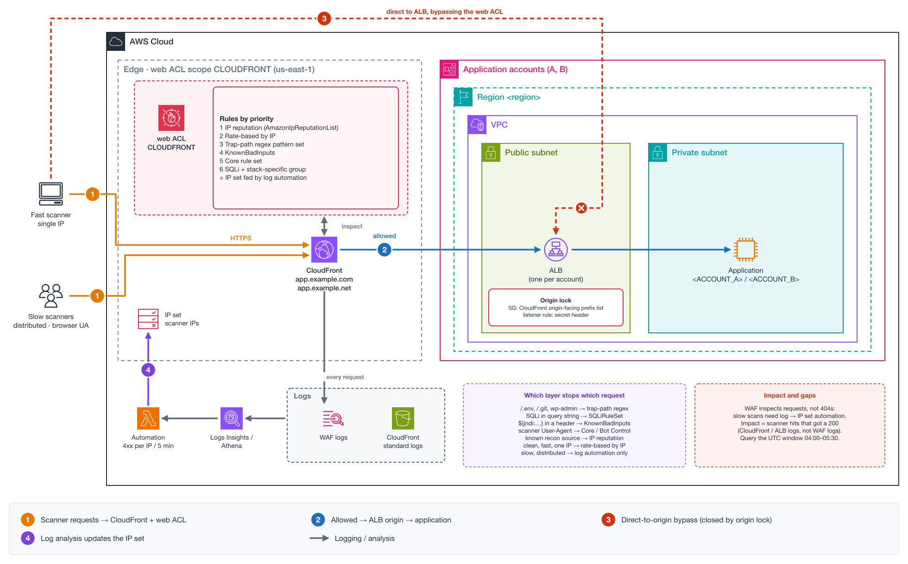

# NET-026 — Automated Vulnerability Scanning Through CloudFront: Layered AWS WAF Blocking and Log Analysis

**Tier:** Case analysis
**Status:** Design and analysis method written on 2026-11-03. The customer's distributions, web ACLs and logs have not been read yet, so the current protection level is unknown.
**Services:** AWS WAF (managed rule groups, rate-based rules, regex pattern sets, IP sets) · CloudFront · Elastic Load Balancing (ALB) · CloudWatch Logs · Amazon Athena



[Interactive explainer](explainers/explainer.html) · [`diagram.py`](diagram.py) regenerates the diagrams: `python3 diagram.py`

## Business Context — Agriculture Technology / Customer-facing web platform

An agriculture technology company runs its customer-facing web application in two AWS accounts
(`<ACCOUNT_A>`, `<ACCOUNT_B>`), each with CloudFront in front of Application Load Balancers. Two
public hostnames (`app.example.com`, `app.example.net`) serve the application.

## Problem Statement

During a 90-minute window at night (04:00–05:30 UTC), the security team saw automated HTTP probing
against both applications: requests looking for known vulnerabilities and exposed endpoints. The
team was still assessing impact and asked how to block and analyze this kind of traffic
automatically at the WAF layer.

- **Time zone trap:** the report uses US Eastern time two days after daylight saving time ended, so
  ET is UTC-5. Log queries must use the UTC window.
- **What is unknown:** whether the distributions have a web ACL at all, which rules it has, and
  whether logging is enabled.

## Architecture

```
scanners ──► CloudFront (web ACL, scope CLOUDFRONT, us-east-1) ──► ALB ──► application
    └───────────────── direct to ALB? (bypasses the CloudFront web ACL) ──┘
```

- One distribution per hostname and account; ALBs as origins.
- A CloudFront web ACL lives in `us-east-1` with scope `CLOUDFRONT`, regardless of the ALB Region.
- If the ALB accepts any source, the CloudFront web ACL can be bypassed.

## Analysis

### What a scan looks like

Many distinct URIs from few IPs, a high share of 404/403 responses, tool or HTTP-library
User-Agents (or a spoofed browser UA), and paths for technologies the application doesn't use.
Scanning is reconnaissance: the impact question is whether any scanner request got a **200** on a
path that shouldn't exist.

### Which layer stops which request

| Scanner request | Stopped by |
|---|---|
| `GET /.env`, `/.git/config`, `wp-admin` on a non-WordPress app | Custom regex pattern set rule ("trap paths") |
| SQL injection in the query string | `AWSManagedRulesSQLiRuleSet` |
| `${jndi:ldap://…}` in a header | `AWSManagedRulesKnownBadInputsRuleSet` |
| Scanner User-Agent (`nmap`, `nessus`) | `AWSManagedRulesCommonRuleSet` (`UserAgent_BadBots_HEADER`), Bot Control |
| Source already seen doing reconnaissance | `AWSManagedRulesAmazonIpReputationList` (`AWSManagedReconnaissanceList`) |
| Clean requests at high rate from one IP | Rate-based rule keyed on IP |
| Distributed, low rate per IP, browser UA | None of the above — log-based automation only |

WAF rules inspect the **request**. On CloudFront and ALB, a web ACL can't count 404 responses per
IP (response inspection exists only for the ATP / ACFP groups on CloudFront, for login and
registration endpoints). Slow distributed scans need log analysis that feeds an IP set — the
"scanners and probes" pattern of the *Security Automations for AWS WAF* AWS Solution.

## Recommendation

CloudFront web ACL, in priority order:

1. `AWSManagedRulesAmazonIpReputationList` (25 WCU).
2. Rate-based rule by IP, Block (start around 1,000 requests / 5 min and tune to real traffic).
3. Trap-path rule: regex pattern set of paths the application never serves, Block.
4. `AWSManagedRulesKnownBadInputsRuleSet` (200 WCU).
5. `AWSManagedRulesCommonRuleSet` (700 WCU).
6. `AWSManagedRulesSQLiRuleSet` (200 WCU) plus the stack-specific group.
7. Optional: Bot Control Common with a scope-down.

About 1,350 WCU with a language group, inside the 1,500 WCU base price. New groups on an existing
web ACL go in Count first. Then:

- **Close the bypass:** ALB security group limited to the `com.amazonaws.global.cloudfront.origin-facing`
  prefix list, plus a secret custom header added by CloudFront and required by an ALB listener rule.
- **Enable logging** on every web ACL and CloudFront standard logs, so the next event can be
  analyzed end to end.
- **Automate the slow-scan gap** with log-driven IP set updates.

## Troubleshooting Path

1. List distributions for both hostnames and their `WebACLId`:
   `aws cloudfront list-distributions --query 'DistributionList.Items[].{id:Id,aliases:Aliases.Items,acl:WebACLId}'`.
2. Read each web ACL: `aws wafv2 get-web-acl --scope CLOUDFRONT --region us-east-1 --name <name> --id <id>`.
3. Check logging: `aws wafv2 get-logging-configuration --resource-arn <web-acl-arn> --region us-east-1`.
4. Pull `AllowedRequests` / `BlockedRequests` (`AWS/WAFV2`, `Region=Global`, `Rule=ALL`) for the window.
5. Top scanners in WAF logs (CloudWatch Logs Insights, window 04:00–05:30 UTC):
   ```
   fields httpRequest.clientIp as ip, httpRequest.uri as uri
   | stats count(*) as requests, count_distinct(uri) as paths by ip
   | sort requests desc
   | limit 50
   ```
6. What terminated: `stats count(*) by action, terminatingRuleId`.
7. Impact from CloudFront standard logs (Athena): scanner IPs with `sc_status = 200`, grouped by
   `cs_uri_stem`.
8. Review the ALB security groups for sources other than the CloudFront origin-facing prefix list.

## Common Mistakes

- Creating the web ACL in the ALB's Region instead of `us-east-1` / `CLOUDFRONT`.
- Blocking the attack IPs by hand; scanners rotate. Block by behavior.
- Using `FORWARDED_IP` on a CloudFront web ACL; the source IP already is the viewer.
- Leaving the ALB open to the internet.
- Measuring impact from WAF logs alone; the response code is in CloudFront / ALB logs.

## Lab Reproduction Notes

No lab yet. A useful one: CloudFront + ALB + a small app, the web ACL above in Count, an
open-source scanner run against the lab hostname from two sources (one fast, one slow and
distributed), then the Logs Insights and Athena queries to show which layer catches what and what
only log automation catches.

## Learning Exercises

1. Run a fast scan and a slow distributed scan; compare `terminatingRuleId` distributions.
2. Build the trap-path regex set and measure its false-positive rate on a week of normal traffic.
3. Prove the bypass: reach the ALB directly with and without the origin-facing prefix list.
4. Write the log-driven automation: count 4xx per IP in 5-minute windows and update an IP set.

## References

- [AWS Managed Rules rule groups list](https://docs.aws.amazon.com/waf/latest/developerguide/aws-managed-rule-groups-list.html)
- [IP reputation rule groups](https://docs.aws.amazon.com/waf/latest/developerguide/aws-managed-rule-groups-ip-rep.html)
- [Rate-based rule statement](https://docs.aws.amazon.com/waf/latest/developerguide/waf-rule-statement-type-rate-based.html)
- [Regex pattern set match rule statement](https://docs.aws.amazon.com/waf/latest/developerguide/waf-rule-statement-type-regex-pattern-set-match.html)
- [Restricting access to Application Load Balancers (CloudFront)](https://docs.aws.amazon.com/AmazonCloudFront/latest/DeveloperGuide/restrict-access-to-load-balancer.html)
- [Querying Amazon CloudFront logs (Athena)](https://docs.aws.amazon.com/athena/latest/ug/cloudfront-logs.html)
- [Security Automations for AWS WAF](https://aws.amazon.com/solutions/implementations/security-automations-for-aws-waf/)
