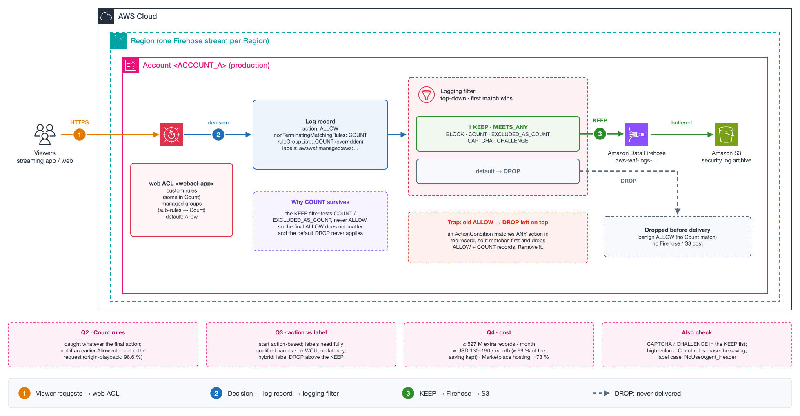

# NET-028 — WAF Logging Filter That Drops Benign ALLOW Traffic but Keeps BLOCK and Every Count Match

**Tier:** Case analysis
**Status:** Design question answered on 2026-11-05 from the AWS WAF logging filter API semantics and a read-only review of the four web ACLs, their logging configurations, 14 days of WAF metrics and the Firehose stream metrics. Impact sized at ×41 records but roughly USD 130–190/month. Not yet replicated in a lab.
**Services:** AWS WAF (logging filters, rule action overrides, labels) · Amazon Data Firehose · Amazon S3 · CloudWatch Metrics



[Interactive explainer](explainers/explainer.html) · [`diagram.py`](diagram.py) regenerates the diagrams: `python3 diagram.py`

## Business Context — Media / Video streaming platform

A media company runs a high-traffic video streaming platform behind AWS WAF. Its security team
streams WAF logs through Amazon Data Firehose into an S3 archive. Almost all requests are benign
and allowed, so log volume drives most of the Firehose and S3 cost.

## Problem Statement

To cut cost, the team configured a logging filter that drops every record with action `ALLOW`
(default behavior: keep). This also drops requests that matched a custom rule in Count or an AWS
managed rule sub-rule overridden to Count, whenever the request finally resolves to the default
Allow. The team loses exactly the telemetry they use to tune rules before switching them to Block.

They propose a new filter — keep `BLOCK`, `COUNT` or `EXCLUDED_AS_COUNT`, default drop — and ask:

1. Is a request that matches a managed sub-rule in Count and ends in the default Allow still kept,
   or does the final ALLOW make the default drop apply?
2. Does the `COUNT` condition reliably catch custom rules in Count that end in the default Allow?
3. Action-based or label-based filtering — which one does AWS recommend, and is there a
   performance, latency or maintenance difference?
4. How much will the extra records cost compared with the current savings?

## Architecture

- **Account:** `<ACCOUNT_A>` (production).
- **Web ACL:** `<webacl-app>`, default action Allow. Custom rules (some in Count) and AWS managed
  rule groups with several sub-rules overridden to Count via `RuleActionOverrides`.
- **Logging:** web ACL → Firehose stream `aws-waf-logs-<name>` → S3 bucket `<bucket-waf-logs>`.

```
viewers ──► web ACL ──► decision ──► log record ──► logging filter ──KEEP──► Firehose ──► S3
                                     action: ALLOW        │
                                     nonTerminating: COUNT └──DROP──► never delivered (no cost)
```

## Root Cause / Recommendation

How the filter works (from the API definitions):

1. AWS WAF builds the log record after the request decision. `action` holds the terminating action.
   Count matches are listed in `nonTerminatingMatchingRules` (web ACL rules) and in
   `ruleGroupList[].nonTerminatingMatchingRules` (rule group rules, with `overriddenAction`).
2. An `ActionCondition` matches **any** action in the record, not only the terminating one. A record
   with `ALLOW` + a Count match meets both `ALLOW` and `COUNT`. That is why the current
   `ALLOW → DROP` filter drops the Count matches.
3. Filters are evaluated **top-down; the first filter that matches decides**. `DefaultBehavior`
   applies only when no filter matches.
4. `COUNT` matches rules configured as Count and sub-rules overridden to Count with the current
   override option. `EXCLUDED_AS_COUNT` overlaps: it matches both the current override and the
   legacy `ExcludedRules`.
5. `LabelNameCondition` requires a **fully qualified** label name. There is no namespace or wildcard
   match.

Answers:

| # | Answer |
|---|---|
| Q1 | **Kept.** The record meets `COUNT`/`EXCLUDED_AS_COUNT`, so the KEEP filter matches and the default drop never applies. The final ALLOW does not matter, because no filter tests ALLOW. Condition: the old `ALLOW → DROP` filter must be removed — if it stays above the KEEP filter it matches first and drops the record. |
| Q2 | **Yes.** `COUNT` catches every custom Count rule that matched, regardless of the final action. Exception: requests terminated earlier by an explicit Allow rule (for example an IP allowlist at priority 0) never reach the Count rules, so the record has no Count match. |
| Q3 | **Start with action-based.** It covers new Count rules automatically. Label-based gives tighter volume control but needs one condition per fully qualified label, and custom rules only have labels if they define `RuleLabels`. Logging filters act on the log record after the decision: they use no WCU and are not in the request path; AWS documents no latency difference between the two. Best of both: put a `DROP` filter for the labels of known noisy Count rules **above** the action-based KEEP filter. |
| Q4 | The extra volume is only the ALLOW requests that matched at least one Count rule — everything else is already kept today. Measure it with `CountedRequests` vs `AllowedRequests` before the change (per-rule sums are an upper bound: one request can match several rules). |

Two more risks in the proposal:

- **CAPTCHA and CHALLENGE.** Today they are kept (default keep). With default drop they disappear.
  Add both to the KEEP condition if the web ACL uses them.
- **High-volume Count rules.** A Count rule that matches most traffic (label-only tagging rules,
  rate-based rules in Count, geo marking) makes `COUNT` keep almost everything and erases the saving.

## What Was Verified

All checks were read-only. Four web ACLs: two CLOUDFRONT scope (edge: *content* and *playback*) and two
REGIONAL (origin: *content* and *playback*), logging to one Firehose stream per Region.

| # | Check | Question | Result |
|---|---|---|---|
| 1 | `ListLoggingConfigurations` (both scopes) | Same filter everywhere? | All four: one `DROP` filter on `ALLOW`, default `KEEP`. Two Firehose streams (us-east-1 for edge, Sydney for origin) |
| 2 | Firehose `IncomingRecords` vs WAF `BlockedRequests` (14 days) | Does the current filter behave as expected? | Records delivered = blocked requests (≈5.82 M edge, ≈0.31 M origin). Average record: 2,021 B (edge), 2,259 B (origin) |
| 3 | `GetWebACL` × 4 | Which rules are in Count? Which Allow rules run before them? | Count: CRS sub-rules (`SizeRestrictions_*`, `NoUserAgent_HEADER`, `CrossSiteScripting_BODY`, `GenericLFI_BODY`), `SQLi_QUERYARGUMENTS`, `SQLi_BODY`, `HostingProviderIPList`, and in edge-playback a third-party Marketplace IP-intelligence group with `hosting`, `vpn`, `relay_proxy` in Count. No CAPTCHA/Challenge in use |
| 4 | `CountedRequests` (rule `ALL` and per rule), 14 days | How many extra records? | Upper bound ≈527 M/month (vs 13.1 M today), ≈1.07 TB/month. edge-playback is 90 % of it; inside it the Marketplace `hosting` sub-rule is 73 % and `SQLi_QUERYARGUMENTS` 19 % |
| 5 | Daily `CountedRequests` | Spike or steady? | Steady: `hosting` 9–15 M/day, `SQLi_QUERYARGUMENTS` 2.4–3.5 M/day |
| 6 | Allow rules before the managed groups | Q2 exception in practice | In origin-playback a host/path Allow rule at priority 13 ends 98.6 % of requests before SQLi (15) and CRS (19): those requests can never carry a Count match |
| 7 | Firehose metrics | Hidden cost dimensions? | Dynamic partitioning with JQ and record format conversion are active (billed per GB on top of ingestion). 0 throttled records |

**Cost (example us-east-1 list prices):** extra Firehose ≈ USD 76 (Direct PUT, 5 KB rounding) or ≈ USD 139
(per-GB vended-logs rate) + ≈ USD 19 format conversion + ≈ USD 33 dynamic partitioning and JQ ≈ **USD 130–190/month**,
plus ≈ USD 25/month of raw S3 per month retained. Logging everything would cost ≈ USD 16,000–25,000/month, so the
proposal keeps ≈ 99 % of the saving. The billed Firehose usage type must be confirmed in the bill.

**Side findings in the web ACLs:**

- **Count + label-based *Allow*.** Several sub-rules in Count are followed by Allow rules that match their label plus a
  host/path. Nothing blocks the rest, so those sub-rules block nothing, and the excepted requests also skip the
  rate-based and IP rules that come later. The intended pattern is a *Block* rule with `label AND NOT exception`.
- **Label case.** One exception rule matches `…core-rule-set:NoUserAgent_HEADER`; the real label is
  `…core-rule-set:NoUserAgent_Header`. It recorded zero allows in 14 days while the sub-rule counted 239–1,241 requests.

## Resolution

Single KEEP filter, default drop:

```json
{
  "DefaultBehavior": "DROP",
  "Filters": [{
    "Behavior": "KEEP",
    "Requirement": "MEETS_ANY",
    "Conditions": [
      { "ActionCondition": { "Action": "BLOCK" } },
      { "ActionCondition": { "Action": "COUNT" } },
      { "ActionCondition": { "Action": "EXCLUDED_AS_COUNT" } },
      { "ActionCondition": { "Action": "CAPTCHA" } },
      { "ActionCondition": { "Action": "CHALLENGE" } }
    ]
  }]
}
```

Optional hybrid, when one Count rule is noisy and has no tuning value:

```json
{
  "DefaultBehavior": "DROP",
  "Filters": [
    { "Behavior": "DROP", "Requirement": "MEETS_ALL",
      "Conditions": [
        { "LabelNameCondition": { "LabelName": "<fully-qualified-label-of-the-noisy-count-rule>" } },
        { "ActionCondition": { "Action": "ALLOW" } } ] },
    { "Behavior": "KEEP", "Requirement": "MEETS_ANY",
      "Conditions": [
        { "ActionCondition": { "Action": "BLOCK" } },
        { "ActionCondition": { "Action": "COUNT" } },
        { "ActionCondition": { "Action": "EXCLUDED_AS_COUNT" } } ] }
  ]
}
```

`MEETS_ALL` with `ALLOW` keeps blocked requests that carry the noisy label. ⚠️ It still drops allowed requests
that carry the noisy label **and** another Count match. Take the exact label name from a real log record first.
In this case the candidate is the Marketplace `hosting` sub-rule (≈73 % of the extra volume).

## Troubleshooting Path

1. Export the current filter:
   ```
   aws wafv2 get-logging-configuration --resource-arn <webacl-arn> \
     --query 'LoggingConfiguration.LoggingFilter' --output json
   ```
2. List rules in Count, explicit Allow rules at low priority, CAPTCHA/Challenge rules and managed overrides:
   ```
   aws wafv2 get-web-acl --scope <REGIONAL|CLOUDFRONT> --name <webacl-app> --id <id> \
     --query 'WebACL.Rules[].{rule:Name,prio:Priority,action:keys(Action||`{}`)[0],overrides:Statement.ManagedRuleGroupStatement.RuleActionOverrides[].Name}' \
     --output table
   ```
3. Size the extra volume with daily `CountedRequests` and `AllowedRequests` (`AWS/WAFV2`, dimensions
   `WebACL`, `Rule`, `Region`; `Region=Global` for CLOUDFRONT scope):
   ```
   aws cloudwatch get-metric-statistics --namespace AWS/WAFV2 --metric-name CountedRequests \
     --dimensions Name=WebACL,Value=<webacl-app> Name=Rule,Value=<rule-metric-name> Name=Region,Value=<region> \
     --start-time <14-days-ago> --end-time <now> --period 86400 --statistics Sum
   ```
4. Estimate: extra GB/month ≈ allowed requests with a Count match × average record size. Price it
   with the Firehose ingestion model of the stream and the S3 storage class and retention in use.
5. Apply the new filter in one `put-logging-configuration` call (replaces the whole filter), then
   confirm the first records with Count matches arrive in S3.

## Common Mistakes

- Adding the KEEP filter and leaving `ALLOW → DROP` above it.
- Using a label namespace in `LabelNameCondition` — only fully qualified names match.
- Switching the default to drop and losing CAPTCHA/CHALLENGE records.
- Estimating cost without `CountedRequests` — one high-volume Count rule can cancel the saving.
- Expecting Count matches for requests already terminated by an Allow rule.

## Lab Reproduction Notes

No lab yet. CloudWatch Logs is used as the destination in the lab because records show up in
minutes; the filter behaves the same for Firehose.

### Replication Method — CLI-first

⚠️ Run only in a lab account. The security group admits your IP only.

| # | Phase | Command | Expected |
|---|---|---|---|
| 1 | Build | `VPC=$(aws ec2 describe-vpcs --filters Name=isDefault,Values=true --query 'Vpcs[0].VpcId' --output text)`; two default subnets into `$SUBNETS`; `MYIP=$(curl -s https://checkip.amazonaws.com)` | VPC and two subnet IDs |
| 2 | Build | `aws ec2 create-security-group …` + `authorize-security-group-ingress --port 80 --cidr $MYIP/32`; `aws elbv2 create-load-balancer --name net028-alb …`; listener with `Type=fixed-response,FixedResponseConfig={StatusCode=200,…}` | `curl http://$DNS/` → `ok` |
| 3 | Build | `aws wafv2 create-web-acl --name net028-acl --scope REGIONAL --default-action Allow={} --rules file://rules.json --cli-binary-format raw-in-base64-out …` with rules: `lab-count-header` (header `x-lab-test: count`, Count), `AWSManagedRulesCommonRuleSet` with `NoUserAgent_HEADER` overridden to Count, `lab-block-header` (header `x-lab-test: block`, Block); then `associate-web-acl` | Web ACL ARN |
| 4 | Break | `aws logs create-log-group --log-group-name aws-waf-logs-net028`; `aws wafv2 put-logging-configuration` with `ALLOW → DROP`, default `KEEP` | `"KEEP"` |
| 5 | Verify | `curl` four requests: normal, `-H 'x-lab-test: count'`, `-H 'User-Agent:'`, `-H 'x-lab-test: block'` | `200 200 200 403` |
| 6 | Verify | `aws logs filter-log-events --log-group-name aws-waf-logs-net028 --query 'events[].message' --output text \| jq -r '[.action,.terminatingRuleId,…]\|@tsv'` | **Symptom:** only `BLOCK lab-block-header`. 📸 `lab/evidence/01-symptom-count-dropped.png` |
| 7 | Fix | `put-logging-configuration` with the single KEEP filter from *Resolution*, default `DROP` | five actions listed |
| 8 | Verify | Repeat 5–6 | `ALLOW … lab-count-header`, `ALLOW … NoUserAgent_HEADER`, `BLOCK lab-block-header`; normal request absent. 📸 `lab/evidence/02-fix-count-kept.png` |
| 9 | Optional | Put `ALLOW → DROP` above the KEEP filter, repeat 5–6 | Count records disappear again (first match wins) |
| 10 | Teardown | `delete-logging-configuration` → `disassociate-web-acl` → `delete-web-acl --lock-token …` → `elbv2 delete-load-balancer` + `wait load-balancers-deleted` → `ec2 delete-security-group` → `logs delete-log-group` | no errors |

The full commands, with copy buttons, are in the [interactive explainer](explainers/explainer.html#replicate).
Capture screenshots with `screencapture -iW lab/evidence/<step>.png` on the CloudWatch log group view.

## Learning Exercises

1. Add a rate-based rule in Count with a high limit. How does the kept volume change, and how would you exclude it?
2. Rewrite the filter as label-based for two specific managed sub-rules. Which custom Count rule is now lost, and how do `RuleLabels` fix it?
3. Build the hybrid filter. Send a request that carries the noisy label and is blocked. Is it kept? Fix it with `MEETS_ALL`.
4. Put an IP allowlist rule at priority 0 and send `x-lab-test: count` from that IP. Explain why no Count match is logged.

## References

- [Log filtering and redaction](https://docs.aws.amazon.com/waf/latest/developerguide/logging-management.html)
- [Configuring logging (filters evaluated from the top)](https://docs.aws.amazon.com/waf/latest/developerguide/logging-management-configure.html)
- [ActionCondition](https://docs.aws.amazon.com/waf/latest/APIReference/API_ActionCondition.html) · [LabelNameCondition](https://docs.aws.amazon.com/waf/latest/APIReference/API_LabelNameCondition.html) · [LoggingFilter](https://docs.aws.amazon.com/waf/latest/APIReference/API_LoggingFilter.html)
- [Log fields for web ACL traffic](https://docs.aws.amazon.com/waf/latest/developerguide/logging-fields.html)
- [Pricing for logging web ACL traffic](https://docs.aws.amazon.com/waf/latest/developerguide/logging-pricing.html)
